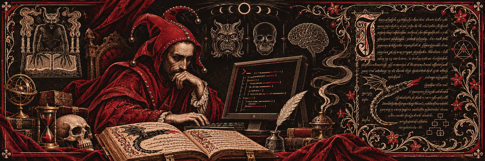
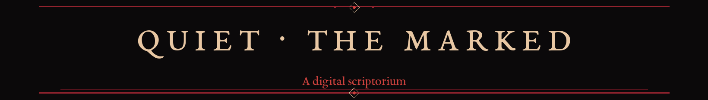
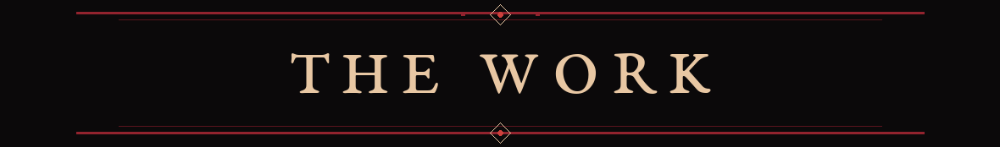

 

 

*Software engineering · Cybersecurity · Applied intelligence · Automation*

<table>
<tr>
<td width="33%" align="center">
<strong>THE CRAFT</strong>  
Software, tools, and systems built to be used.
</td>
<td width="33%" align="center">
<strong>THE INQUIRY</strong>  
Security, research, intelligence, and the structures beneath appearances.
</td>
<td width="33%" align="center">
<strong>THE METHOD</strong>  
Observe. Experiment. Build. Refine.
</td>
</tr>
</table>

A working collection of experiments and software, with particular interest in:

- **Systems and security** — cybersecurity, OSINT, and technical investigation.
- **Applied AI** — useful assistants, research tooling, and local inference.
- **Automation** — repeatable workflows and software that reduces manual work.
- **Engineering** — Python, TypeScript, Linux, and full-stack applications.

THE MANUSCRIPT IS NEVER FINISHED.

  

<a href="https://github.com/Quiet-TheMarked?tab=repositories">Browse repositories</a>

