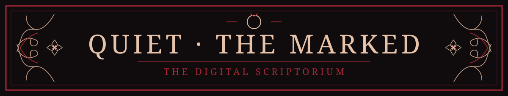
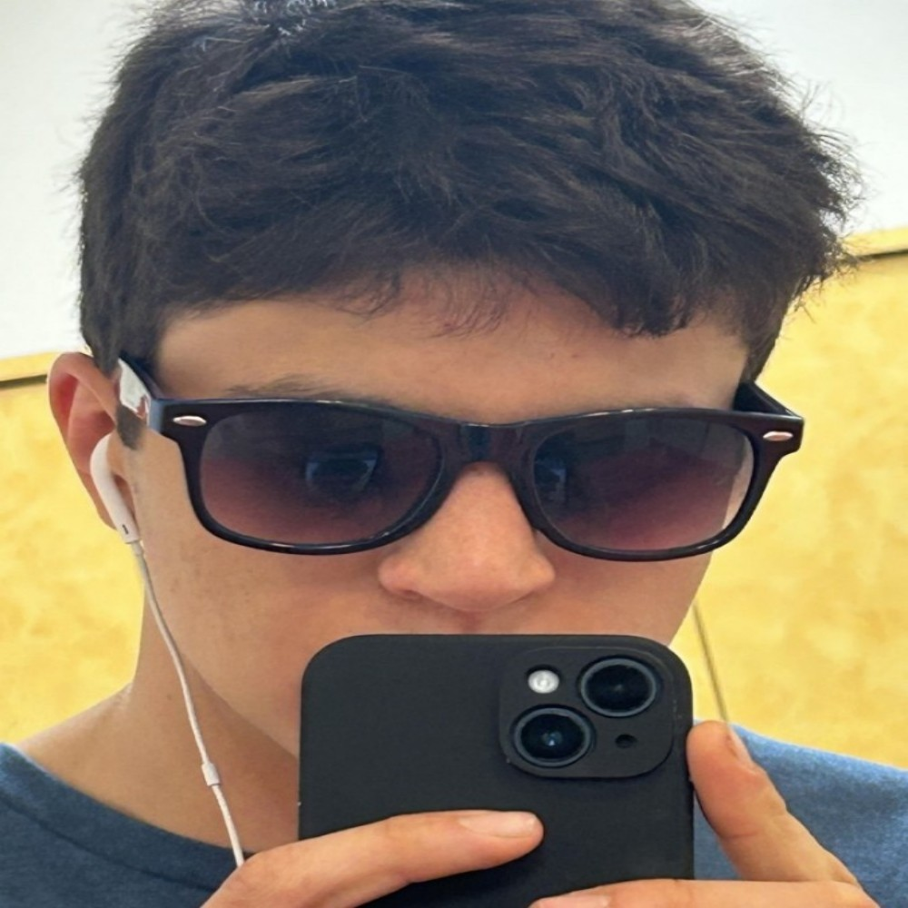
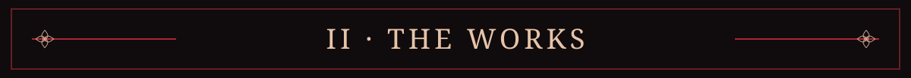
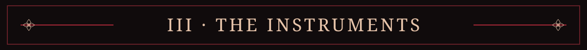
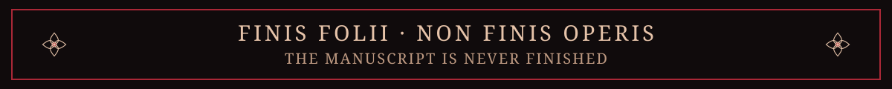

<div align="center">



**Software engineering · Cybersecurity · Applied intelligence · Automation**

<sub>Crafting practical systems. Investigating the machinery beneath appearances.</sub>


</div>

<table>
<tr>
<td width="27%" align="center" valign="middle">

</td>
<td valign="middle">

### Folio I · The Author

Developer and researcher working across software engineering, cybersecurity, autonomous systems, and applied intelligence. The emphasis is on **usable results**, deliberate constraints, and technical investigation.

`Linux` · `Python` · `TypeScript` · `Cybersecurity` · `AI`

</td>
</tr>
</table>

<div align="center">

</div>

| Manuscript | Discipline | Subject |
| :--- | :--- | :--- |
| **RoleProwl** | Software · Automation | Job-search and application assistance |
| **Weave** | Intelligence · Research | Curated information and discovery |
| **AED** | Applied intelligence | Economic information discovery and experimentation |
| **Security investigations** | Cybersecurity · OSINT | Evidence-driven technical investigations |

<sub>These are areas of ongoing work. Some projects or experiments are not yet public.</sub>

<div align="center">

**[✦ Browse public repositories ✦](https://github.com/Quiet-TheMarked?tab=repositories)**



</div>

```text
$ cat /etc/quiet-themarked
operator : quiet-themarked
practice : engineering / security / intelligence
methods  : research → build → verify → ship
terrain  : linux / web / automation / local AI
```

<details>
<summary><b>✧ Open the marginalia — areas of inquiry</b></summary>

- **Systems:** Software architecture, operating systems, and working tools.
- **Security:** Cybersecurity, OSINT, and technical investigation.
- **Intelligence:** Research, source evaluation, and useful discovery.
- **Automation:** Purpose-built software, deliberate constraints, and autonomous workflows.

</details>

<br>

<div align="center">

</div>
